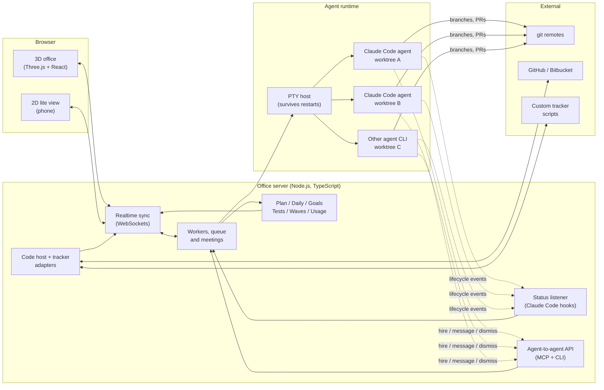

# Agent Office

**A virtual 3D office where I run a team of Claude Code agents in parallel, each at its own desk, on its own git worktree.**

> Source code is private. This repository only describes the project.
> I'm happy to demo it live in an interview.

---

## Why I built it

I do almost all of my development through coding agents now. Once I had four or five Claude Code sessions going at the same time, the hard part was no longer writing code. It was keeping track: which agent is on which task, which one is stuck waiting for my answer, which branch is ready for review, and where my weekly usage limit went.

Terminal tabs didn't scale, so I moved my work into an office. Every agent sits at a desk, its terminal is on the laptop in front of it, and the walls show the issues, pull requests and plans it is working from. I live in it every working day and keep adding automations whenever I notice I'm doing something by hand twice.

It started from the open-source [Agent Office](https://github.com/AgentSystemLabs/agent-office) by Web Dev Cody. My private fork follows upstream and adds around a hundred pull requests of my own, mostly around orchestration, tracking and visibility for agent-driven work.

## Key features

**Running agents in parallel**
- Hire a worker at any desk: Claude Code (or Codex, OpenCode and other agent CLIs), with its model and reasoning effort.
- Every worker can get its own **git worktree and branch**, cut from a freshly fetched base, so parallel agents never step on each other. One task can span several repositories, with a linked PR in each.
- Live, shared terminals: the agent's screen renders on its in-world laptop, and I can open it and type at any time. Terminals survive server restarts.
- A **task queue** that seats tasks at free desks up to a concurrency limit, and opens the PR when the work is done.

**Knowing what needs me**
- Agent status comes from Claude Code hooks: working, waiting for input, asking permission, done.
- A worker that needs an answer lights a beacon over its desk, raises a banner and plays an alert. One key jumps straight to whoever is waiting.
- A **Changes** window per desk shows the live diff against the base branch, with commit, discard, push and "open PR" in one place.
- A 2D "lite" view for checking on agents from my phone.

**Agents that manage agents**
- Every worker can list, hire, message and dismiss other workers through an MCP server and a small CLI. I can tell one agent to "send everyone whose PR merged home" and it cleans up their worktrees.
- **Context handoff:** an agent can end its turn with a handoff note. The office clears its context, optionally switches it to a cheaper or stronger model, and feeds the note back in as the next prompt. Long tasks carry on from a written plan instead of a context near its limit.

**Day-to-day overview (my additions)**
- **Pluggable code hosts and trackers:** GitHub and Bitbucket pull requests behind one interface, plus issue boards fed by any command I write. One of mine lays out a project's roadmap "waves" in Kanban columns, worked out from branches, PRs and open questions.
- **Plan** panel: this week's planned work from a Markdown table in git, with chips that turn green as the work merges.
- **Daily** panel: what got merged and moved today, plus today's share of the weekly limit.
- **Goals** panel: daily targets (for example, plans written or PRs opened) with a weekly strip.
- **Tests** panel: each worker's background test run with a progress bar against the last green run.
- **Waves** panel: which phase of my feature workflow each agent is in (design, plan, approval, implementation, review...).
- **Usage tracking:** records where the week's Claude plan limit goes, per worker, wave and subagent, as a timeline.
- **Later** list for deliberately postponed items, visible to me and to the agents.
- **Workshop** board for side tools and automations, and a **Bookshelf** that renders the project's docs and Mermaid diagrams.

**Working together**
- Multiplayer: teammates walk around the same office, with voice chat, screen sharing and a shared Excalidraw whiteboard.
- Ports a worker's dev server opens are detected and can be tunnelled to your own machine.

## How it works

- **Agents.** Each worker is a real agent CLI running in a pseudo-terminal. A separate PTY host process owns the terminals, so the server can restart or upgrade without killing running agents. A headless terminal mirror on the server produces the laptop screens and snapshots for anyone who joins late.
- **Worktrees.** Hiring with "own worktree" creates a fresh branch from the latest remote base in an isolated checkout. That is what makes real parallelism safe: five agents, five branches, zero shared working copies. When a PR merges, the worker can be sent home and its worktree cleaned up automatically.
- **Orchestration.** Status comes from agent lifecycle hooks rather than screen scraping. The task queue, meetings (several agents in one shared worktree with roles) and the agent-to-agent API all run on top of the same worker model.
- **UI.** A Three.js world where each code repository is a floor of the building. All state is server-authoritative and synced over WebSockets; voice and screen sharing go peer-to-peer over WebRTC.
- **Automations.** Panels and boards are plug-in modules. Many of them read from git, the code host, or a small script that prints JSON, so adding a new view of my work usually means writing a script, not changing the server.

## Tech stack

- **Language:** TypeScript end to end (strict), Node.js 20+
- **Frontend:** React 18, Three.js, Vite, xterm.js, Excalidraw, Mermaid, marked + DOMPurify
- **Backend:** Node.js, WebSockets (`ws`), node-pty, headless xterm, Playwright (headless Chromium for page snapshots)
- **Realtime:** WebSockets for state, WebRTC for voice and screen sharing
- **Agents:** Claude Code (hooks, subagents, skills), MCP, plus other agent CLIs
- **Dev workflow:** git worktrees, GitHub CLI, Bitbucket CLI, Node's built-in test runner (120+ test files), GitHub Actions
- **Deployment:** runs locally or on a small Linux server, reachable over SSH tunnel or a private network

## What I learned

- **Context is the scarcest resource.** Most of the token spend was the agent re-reading long contexts, not producing output. Letting an agent write down its plan and restart from a clean context (the handoff) did more for quality and cost than any prompt tweak.
- **Parallelism needs isolation first.** Agents only became truly parallel once each one had its own worktree and branch from a fresh base. Before that, I spent my time untangling shared checkouts.
- **My job moved to review.** With several agents shipping PRs a day, the bottleneck is me reading diffs. Small, scoped PRs, a live diff per desk, and a clear "who is waiting on me" signal matter more than raw agent speed.
- **Make the rules executable.** Conventions in an instructions file get skipped. Conventions enforced by tests (for example, a test that limits file sizes so features stay modular) actually hold.
- **Measure before optimising.** Recording where the usage limit went, per worker and per subagent, replaced guesses with numbers and showed that subagents made most of the API calls.

## Status

In daily use and changing fast. The code is private because it is wired into my real working setup, but I'm happy to walk through it and demo it live in an interview.

**Andrej Meliška** · Fullstack TypeScript developer, Prague
[LinkedIn](https://www.linkedin.com/in/andrej-meli%C5%A1ka-15278026b/) · [Portfolio](https://andrej.meliska.sk/)
